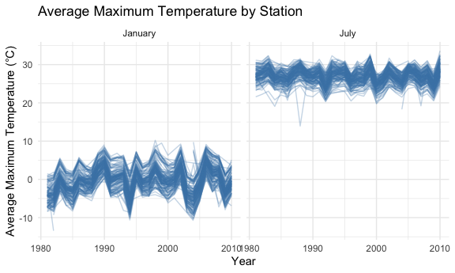
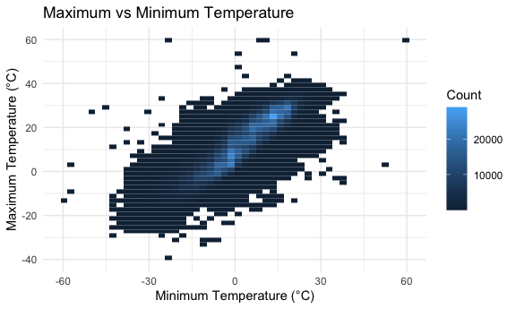
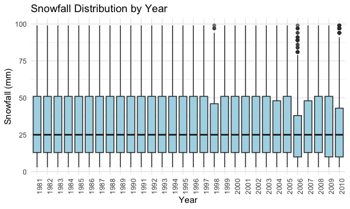
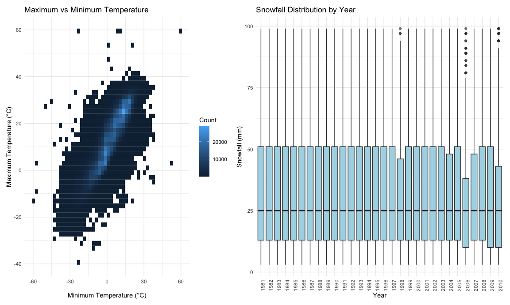
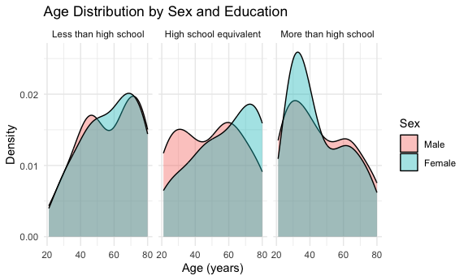
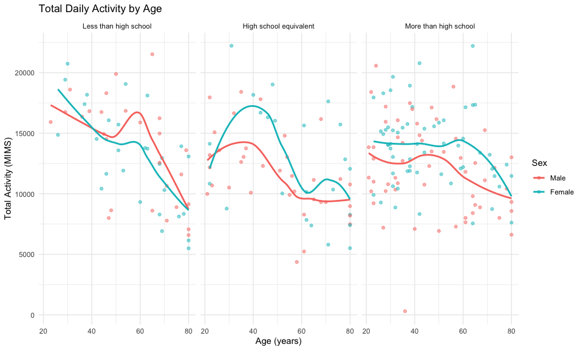
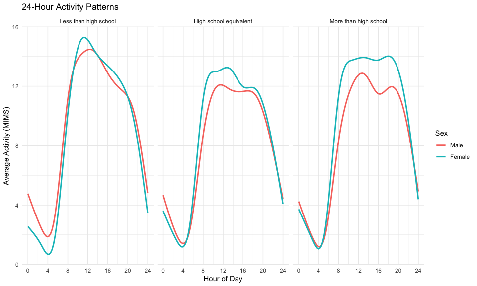
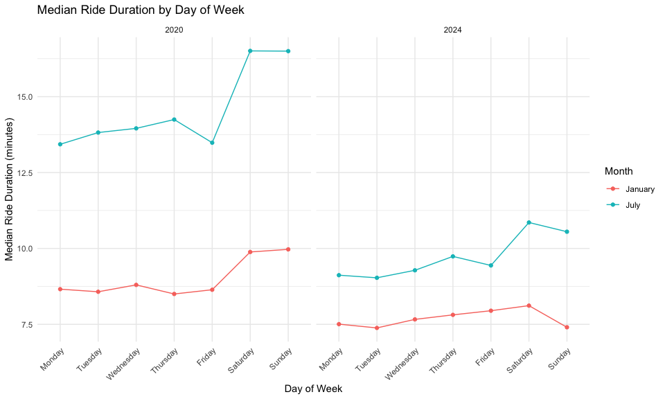
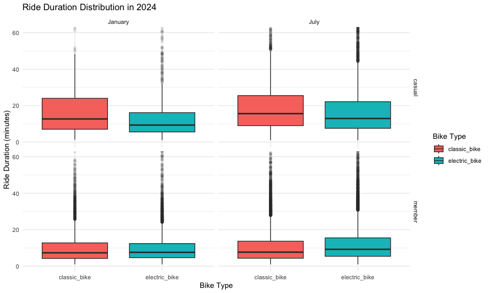

P8105 hw3
================
Yahan Xue

# Problem 1

## Data import and description

``` r
data("ny_noaa")

dim(ny_noaa)
```

    ## [1] 2595176       7

The `ny_noaa` dataset contains 2,595,176 observations and 7 variables.
It includes daily meteorological observations from weather stations
across New York State.

Key variables include station ID (`id`), observation date (`date`),
precipitation (`prcp`), snowfall (`snow`), snow depth (`snwd`), maximum
temperature (`tmax`), and minimum temperature (`tmin`).

``` r
missing_summary = ny_noaa |>
  summarize(
    across(
      everything(),
      ~ sum(is.na(.x))
    )
  )

missing_summary
```

    ## # A tibble: 1 × 7
    ##      id  date   prcp   snow   snwd    tmax    tmin
    ##   <int> <int>  <int>  <int>  <int>   <int>   <int>
    ## 1     0     0 145838 381221 591786 1134358 1134420

``` r
missing_percent = ny_noaa |>
  summarize(
    across(
      everything(),
      ~ mean(is.na(.x)) * 100
    )
  )

missing_percent
```

    ## # A tibble: 1 × 7
    ##      id  date  prcp  snow  snwd  tmax  tmin
    ##   <dbl> <dbl> <dbl> <dbl> <dbl> <dbl> <dbl>
    ## 1     0     0  5.62  14.7  22.8  43.7  43.7

The `ny_noaa` dataset contains 2,595,176 observations and 7 variables.
It includes daily weather records from weather stations across New York
State.

The key variables include station ID (`id`), date (`date`),
precipitation (`prcp`), snowfall (`snow`), snow depth (`snwd`), maximum
temperature (`tmax`), and minimum temperature (`tmin`).

Missing values are present in several weather variables. In particular,
missing temperature measurements may affect the analysis of daily
maximum and minimum temperatures. Missing observations will be handled
appropriately when calculating summaries and producing visualizations.

## Data cleaning

``` r
noaa_clean = ny_noaa |>
  mutate(
    year = lubridate::year(date),
    month = lubridate::month(date),
    day = lubridate::day(date),
    tmax = as.numeric(tmax) / 10,
    tmin = as.numeric(tmin) / 10,
    prcp = prcp / 10
  )

glimpse(noaa_clean)
```

    ## Rows: 2,595,176
    ## Columns: 10
    ## $ id    <chr> "US1NYAB0001", "US1NYAB0001", "US1NYAB0001", "US1NYAB0001", "US1…
    ## $ date  <date> 2007-11-01, 2007-11-02, 2007-11-03, 2007-11-04, 2007-11-05, 200…
    ## $ prcp  <dbl> NA, NA, NA, NA, NA, NA, NA, NA, NA, NA, NA, NA, NA, NA, NA, NA, …
    ## $ snow  <int> NA, NA, NA, NA, NA, NA, NA, NA, NA, NA, NA, NA, NA, NA, NA, NA, …
    ## $ snwd  <int> NA, NA, NA, NA, NA, NA, NA, NA, NA, NA, NA, NA, NA, NA, NA, NA, …
    ## $ tmax  <dbl> NA, NA, NA, NA, NA, NA, NA, NA, NA, NA, NA, NA, NA, NA, NA, NA, …
    ## $ tmin  <dbl> NA, NA, NA, NA, NA, NA, NA, NA, NA, NA, NA, NA, NA, NA, NA, NA, …
    ## $ year  <dbl> 2007, 2007, 2007, 2007, 2007, 2007, 2007, 2007, 2007, 2007, 2007…
    ## $ month <dbl> 11, 11, 11, 11, 11, 11, 11, 11, 11, 11, 11, 11, 11, 11, 11, 11, …
    ## $ day   <int> 1, 2, 3, 4, 5, 6, 7, 8, 9, 10, 11, 12, 13, 14, 15, 16, 17, 18, 1…

``` r
snow_frequency = noaa_clean |>
  count(snow, sort = TRUE)

head(snow_frequency, 10)
```

    ## # A tibble: 10 × 2
    ##     snow       n
    ##    <int>   <int>
    ##  1     0 2008508
    ##  2    NA  381221
    ##  3    25   31022
    ##  4    13   23095
    ##  5    51   18274
    ##  6    76   10173
    ##  7     8    9962
    ##  8     5    9748
    ##  9    38    9197
    ## 10     3    8790

``` r
noaa_clean |>
  filter(!is.na(snow)) |>
  count(snow, sort = TRUE) |>
  head(10)
```

    ## # A tibble: 10 × 2
    ##     snow       n
    ##    <int>   <int>
    ##  1     0 2008508
    ##  2    25   31022
    ##  3    13   23095
    ##  4    51   18274
    ##  5    76   10173
    ##  6     8    9962
    ##  7     5    9748
    ##  8    38    9197
    ##  9     3    8790
    ## 10   102    6552

The most common snowfall value is 0 mm, with 2,008,508 observations. The
next most common values are 25 mm, 13 mm, and 51 mm. This makes sense
because most days have no snowfall. The dataset also contains 381,221
missing snowfall observations. \## Average maximum temperature in
January and July

``` r
noaa_temp = noaa_clean |>
  filter(month %in% c(1, 7)) |>
  group_by(id, year, month) |>
  summarize(
    mean_tmax = mean(tmax, na.rm = TRUE),
    .groups = "drop"
  ) |>
  filter(!is.nan(mean_tmax))

head(noaa_temp)
```

    ## # A tibble: 6 × 4
    ##   id           year month mean_tmax
    ##   <chr>       <dbl> <dbl>     <dbl>
    ## 1 USC00300023  1981     1     -3.17
    ## 2 USC00300023  1981     7     28.3 
    ## 3 USC00300023  1982     1     -4.32
    ## 4 USC00300023  1982     7     27.8 
    ## 5 USC00300023  1983     1      1.11
    ## 6 USC00300023  1983     7     29.8

``` r
noaa_temp |>
  ggplot(aes(x = year, y = mean_tmax, group = id)) +
  geom_line(alpha = 0.3, color = "steelblue") +
  facet_grid(. ~ month,
             labeller = as_labeller(
               c(`1` = "January", `7` = "July")
             )) +
  labs(
    title = "Average Maximum Temperature by Station",
    x = "Year",
    y = "Average Maximum Temperature (°C)"
  ) +
  theme_minimal()
```


Average maximum temperatures are much higher in July than in January.
January temperatures vary more across years, while July temperatures are
relatively stable. There are also a few unusual values, especially in
July, where some stations have much lower average temperatures than the
others. Overall, there is no clear long-term increasing or decreasing
trend.

## Temperature relationship and snowfall distribution

``` r
temp_plot = noaa_clean |>
  filter(!is.na(tmax), !is.na(tmin)) |>
  ggplot(aes(x = tmin, y = tmax)) +
  geom_bin2d(bins = 50) +
  labs(
    title = "Maximum vs Minimum Temperature",
    x = "Minimum Temperature (°C)",
    y = "Maximum Temperature (°C)",
    fill = "Count"
  ) +
  theme_minimal()

temp_plot
```



``` r
snow_plot = noaa_clean |>
  filter(snow > 0, snow < 100) |>
  ggplot(aes(x = factor(year), y = snow)) +
  geom_boxplot(
    fill = "lightblue",
    outlier.alpha = 0.2
  ) +
  labs(
    title = "Snowfall Distribution by Year",
    x = "Year",
    y = "Snowfall (mm)"
  ) +
  theme_minimal() +
  theme(
    axis.text.x = element_text(
      angle = 90,
      hjust = 1
    )
  )

snow_plot
```



``` r
(temp_plot | snow_plot) +
  patchwork::plot_layout(widths = c(1, 1.5))
```


There is a clear positive relationship between minimum and maximum
temperatures. As minimum temperature increases, maximum temperature also
tends to increase. Most observations are concentrated in the middle of
the plot, with a few extreme values.Snowfall distributions are similar
across most years. The median snowfall is around 25 mm, and the middle
50% of observations generally falls between about 13 and 51 mm. Some
years, such as 2006 and 2010, show somewhat different distributions.
There is no obvious long-term trend in the snowfall amounts shown.

# Problem 2

## Data import and cleaning

``` r
nhanes_covar = read_csv(
  "data/nhanes_covar.csv",
  skip = 4
) |>
  janitor::clean_names()

nhanes_accel = read_csv(
  "data/nhanes_accel.csv"
) |>
  janitor::clean_names()

nhanes_data = nhanes_covar |>
  filter(age >= 21) |>
  drop_na(sex, age, bmi, education) |>
  mutate(
    sex = factor(
      sex,
      levels = c(1, 2),
      labels = c("Male", "Female")
    ),
    education = factor(
      education,
      levels = c(1, 2, 3),
      labels = c(
        "Less than high school",
        "High school equivalent",
        "More than high school"
      )
    )
  ) |>
  inner_join(nhanes_accel, by = "seqn")

nhanes_data |>
  select(seqn, sex, age, bmi, education) |>
  head()
```

    ## # A tibble: 6 × 5
    ##    seqn sex      age   bmi education             
    ##   <dbl> <fct>  <dbl> <dbl> <fct>                 
    ## 1 62161 Male      22  23.3 High school equivalent
    ## 2 62164 Female    44  23.2 More than high school 
    ## 3 62169 Male      21  20.1 High school equivalent
    ## 4 62174 Male      80  33.9 More than high school 
    ## 5 62177 Male      51  20.1 High school equivalent
    ## 6 62178 Male      80  28.5 High school equivalent

The NHANES demographic and accelerometer datasets were combined using
participant ID (SEQN). Participants under 21 years old and those with
missing demographic information were excluded. Sex and education were
converted into categorical variables for further analysis.

## Demographic characteristics

``` r
nhanes_data |>
  count(education, sex) |>
  pivot_wider(
    names_from = sex,
    values_from = n,
    values_fill = 0
  ) |>
  knitr::kable(
    caption = "Number of participants by sex and education"
  )
```

| education              | Male | Female |
|:-----------------------|-----:|-------:|
| Less than high school  |   27 |     28 |
| High school equivalent |   35 |     23 |
| More than high school  |   56 |     59 |

Number of participants by sex and education

The more than high school group has the largest number of participants,
with 56 males and 59 females. The less than high school group has
similar numbers of males and females, while the high school equivalent
group has more males than females.

``` r
nhanes_data |>
  ggplot(aes(x = age, fill = sex)) +
  geom_density(alpha = 0.4) +
  facet_grid(. ~ education) +
  labs(
    title = "Age Distribution by Sex and Education",
    x = "Age (years)",
    y = "Density",
    fill = "Sex"
  ) +
  theme_minimal()
```


The age distributions vary across education groups. In the more than
high school group, females have a noticeable peak around ages 30–40. The
other two education groups show more spread across ages. Overall, the
age distributions of males and females overlap, but there are some
differences between the groups. \## Total Daily Activity

``` r
nhanes_long = nhanes_data |>
  pivot_longer(
    cols = matches("^min[0-9]+$"),
    names_to = "minute",
    values_to = "mims"
  ) |>
  mutate(
    minute = as.numeric(
      stringr::str_remove(minute, "min")
    ) - 1
  )

nhanes_total = nhanes_long |>
  group_by(seqn, sex, age, education) |>
  summarize(
    total_activity = sum(mims, na.rm = TRUE),
    .groups = "drop"
  )
```

``` r
nhanes_total |>
  ggplot(aes(
    x = age,
    y = total_activity,
    color = sex
  )) +
  geom_point(alpha = 0.5) +
  geom_smooth(se = FALSE) +
  facet_grid(. ~ education) +
  labs(
    title = "Total Daily Activity by Age",
    x = "Age (years)",
    y = "Total Activity (MIMS)",
    color = "Sex"
  ) +
  theme_minimal()
```


Total daily activity generally decreases with age, although there is
considerable variation among participants. The patterns differ somewhat
between males and females across education groups. In the high school
equivalent group, females show higher activity levels than males around
ages 40–50. Overall, the relationship between age and activity is not
perfectly linear.

## 24-Hour Activity Patterns

``` r
nhanes_hourly = nhanes_long |>
  group_by(education, sex, minute) |>
  summarize(
    mean_mims = mean(mims, na.rm = TRUE),
    .groups = "drop"
  ) |>
  mutate(
    hour = minute / 60
  )
```

``` r
nhanes_hourly |>
  ggplot(aes(
    x = hour,
    y = mean_mims,
    color = sex
  )) +
  geom_smooth(
    se = FALSE,
    span = 0.12
  ) +
  facet_grid(. ~ education) +
  scale_x_continuous(
    breaks = seq(0, 24, 4),
    limits = c(0, 24)
  ) +
  labs(
    title = "24-Hour Activity Patterns",
    x = "Hour of Day",
    y = "Average Activity (MIMS)",
    color = "Sex"
  ) +
  theme_minimal()
```


Activity levels are lowest during the early morning 3–5 AM, and increase
rapidly after 6 AM. Activity remains higher during the daytime and
decreases in the evening. The three education groups show similar daily
patterns, and males and females have some differences in activity levels
throughout the day. \# Problem 3 \## Data import and cleaning

``` r
bike_files = list.files(
  "data/citibike",
  pattern = "\\.csv$",
  full.names = TRUE
)

citibike = purrr::map_dfr(
  bike_files,
  function(file) {
    read_csv(file, show_col_types = FALSE) |>
      janitor::clean_names() |>
      mutate(
        year = as.integer(
          str_extract(basename(file), "20[0-9]{2}")
        ),
        month = if_else(
          str_detect(basename(file), "Jan"),
          "January",
          "July"
        )
      )
  }
) |>
  mutate(
    month = factor(
      month,
      levels = c("January", "July")
    ),
    weekdays = factor(
      weekdays,
      levels = c(
        "Monday", "Tuesday", "Wednesday",
        "Thursday", "Friday", "Saturday", "Sunday"
      )
    ),
    member_casual = factor(
      member_casual,
      levels = c("casual", "member")
    )
  )

dim(citibike)
```

    ## [1] 99485     9

``` r
head(citibike)
```

    ## # A tibble: 6 × 9
    ##   ride_id    rideable_type weekdays duration start_station_name end_station_name
    ##   <chr>      <chr>         <fct>       <dbl> <chr>              <chr>           
    ## 1 4BE06CB33… classic_bike  Tuesday     15.3  Columbus Ave & W … E 53 St & Madis…
    ## 2 26886E034… classic_bike  Wednesd…     5.31 2 Ave & E 96 St    1 Ave & E 110 St
    ## 3 24DC56060… classic_bike  Friday       9.69 Columbia St & Riv… Grand St & Eliz…
    ## 4 EEDC10535… classic_bike  Sunday       7.00 W 84 St & Columbu… Columbus Ave & …
    ## 5 2CD4BD4CE… classic_bike  Friday       2.85 Forsyth St & Broo… Suffolk St & St…
    ## 6 E18682F9A… classic_bike  Sunday      25.5  Allen St & Hester… Atlantic Ave & …
    ## # ℹ 3 more variables: member_casual <fct>, year <int>, month <fct>

The Citi Bike dataset contains rides from January and July in 2020 and
2024. It includes information about bike type, membership status, day of
the week, ride duration, and starting and ending stations. The data were
combined into one dataset, with year and month added for each ride.

## Ride Counts by Year and Month

``` r
citibike |>
  count(year, month, member_casual) |>
  pivot_wider(
    names_from = member_casual,
    values_from = n,
    values_fill = 0
  ) |>
  knitr::kable(
    caption = "Number of Rides by Year, Month, and Membership"
  )
```

| year | month   | casual | member |
|-----:|:--------|-------:|-------:|
| 2020 | January |    984 |  11436 |
| 2020 | July    |   5637 |  15411 |
| 2024 | January |   2108 |  16753 |
| 2024 | July    |  10894 |  36262 |

Number of Rides by Year, Month, and Membership

Members took more rides than casual riders in both years. July had more
rides than January in both 2020 and 2024. The number of rides was also
higher in 2024 than in 2020, with July 2024 having the highest number of
rides. \## Most Popular Starting Stations

``` r
citibike |>
  filter(year == 2024, month == "July") |>
  count(start_station_name, sort = TRUE) |>
  slice_head(n = 5) |>
  knitr::kable(
    col.names = c("Starting Station", "Number of Rides"),
    caption = "Top Five Starting Stations in July 2024"
  )
```

| Starting Station         | Number of Rides |
|:-------------------------|----------------:|
| Pier 61 at Chelsea Piers |             163 |
| University Pl & E 14 St  |             155 |
| W 21 St & 6 Ave          |             152 |
| West St & Chambers St    |             150 |
| W 31 St & 7 Ave          |             146 |

Top Five Starting Stations in July 2024

## Median Ride Duration

``` r
citibike |>
  group_by(year, month, weekdays) |>
  summarize(
    median_duration = median(duration, na.rm = TRUE),
    .groups = "drop"
  ) |>
  ggplot(aes(
    x = weekdays,
    y = median_duration,
    color = month,
    group = month
  )) +
  geom_point() +
  geom_line() +
  facet_grid(. ~ year) +
  labs(
    title = "Median Ride Duration by Day of Week",
    x = "Day of Week",
    y = "Median Ride Duration (minutes)",
    color = "Month"
  ) +
  theme_minimal() +
  theme(
    axis.text.x = element_text(
      angle = 45,
      hjust = 1
    )
  )
```


Median ride duration was longer in July than in January for both 2020
and 2024. In 2020, ride duration increased noticeably on weekends,
especially in July. In 2024, weekend rides were also slightly longer,
but the differences were smaller. Overall, median ride durations were
higher in 2020 than in 2024. \## Ride Duration Distribution in 2024

``` r
citibike |>
  filter(year == 2024) |>
  ggplot(aes(
    x = rideable_type,
    y = duration,
    fill = rideable_type
  )) +
  geom_boxplot(outlier.alpha = 0.1) +
  facet_grid(member_casual ~ month) +
  coord_cartesian(ylim = c(0, 60)) +
  labs(
    title = "Ride Duration Distribution in 2024",
    x = "Bike Type",
    y = "Ride Duration (minutes)",
    fill = "Bike Type"
  ) +
  theme_minimal()
```


Casual riders generally had longer rides than members in both January
and July. Among casual riders, classic bikes had higher median ride
durations than electric bikes. For members, electric bike rides were
generally longer, especially in July. Ride durations also showed
considerable variation, with many outliers.
